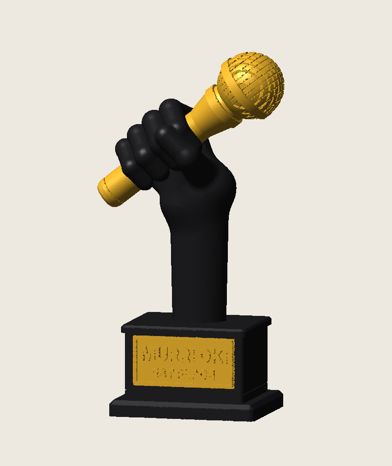
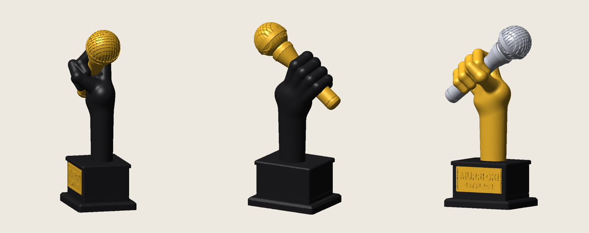

# Murri Oki Karaoke Trophy

A fist holding a microphone on a black stepped base, made as separate parts so you can
print each part in a different colour. Print the base black, then pick the hand colour for
each place (gold / silver / bronze) or keep it black and change only the mic.




About **213 mm tall** once assembled. Each part fits on any Bambu printer (A1, P1S, X1C...).

## Parts (`stl/`)

| File | Suggested colour | Notes |
|---|---|---|
| `base.stl` | Black | Has a square peg on top for the arm and a pocket on the front for the plate. |
| `hand.stl` | Black (or gold / silver / bronze) | Forearm and fist. A square socket underneath fits the base peg. |
| `mic_handle.stl` | Accent colour | Goes in tail first from the top of the fist. The flared collar stops it. |
| `mic_head.stl` | Accent colour | Grille ball. Press it onto the peg on the handle. |
| `plate_1st.stl` / `plate_2nd.stl` / `plate_3rd.stl` | Accent colour + black text | "MURRI OKI" / "1ST PLACE" and so on. |
| `plate_blank.stl` | Any | Add your own text in Bambu Studio (right-click > Add text, or an SVG). |
| `assembly_preview.3mf` | – | The whole trophy put together, for viewing only. Don't print it. |

## Print settings (based on the reference trophy)

- **0.16 mm layer height, 2 walls, 8–15% infill.** Use 15% infill on the base if you want it heavier.
- **Hand:** stand it upright on its flat bottom. Use **tree supports** (Normal(auto) + Tree) for the fingers and thumb. Don't put supports inside the mic hole if you can avoid it. Paint on a support blocker or clean the hole afterwards.
- **Mic handle:** stands on its tail as the STL is oriented. Add a **brim** because it's tall and thin. No supports needed.
- **Mic head:** flat side down. No supports needed.
- **Base:** flat on the bed with the peg facing up. No supports needed.
- **Plates:** flat on the bed with the text facing up. For two-colour text:
  - **AMS:** right-click the plate > *Height range modifier* > from 1.6 mm to the top > black filament.
  - **Single colour:** add a *filament change / pause* at layer **1.6 mm** in the slicer preview.

## Assembly

1. Glue or press the plate into the front pocket. A dab of super glue holds it.
2. Push the hand's socket onto the base peg. Glue it for a permanent trophy.
3. Slide the mic handle in **tail first** from the top of the fist until the collar sits on the knuckles.
4. Press the mic head onto the handle peg. Glue it if it's loose.

Fit clearance is 0.3 mm per side. If your printer prints tight, increase `CLR` in the script.

## Change the design

`generate_trophy.py` builds everything. You can edit the text, sizes, clearance and so on.

```bash
pip install manifold3d trimesh numpy scikit-image matplotlib
python3 generate_trophy.py
```

Edit the `plates = {...}` dictionary near the bottom to change the plate text (e.g. add a year).
